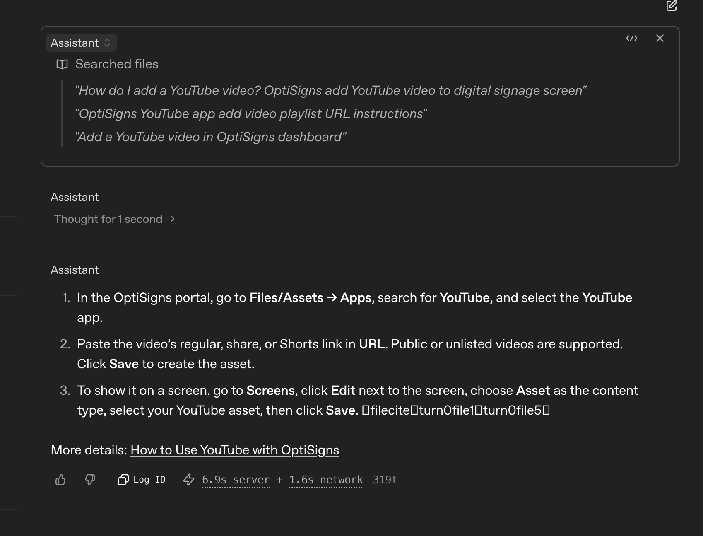

# OptiBot scrape-and-index job

Daily job that scrapes OptiSigns Help Center articles, converts them to Markdown, and uploads only new or changed files into an OpenAI vector store for File search.

## Setup

1. Create an OpenAI API key and a vector store (or reuse an existing store id).
2. Copy `.env.sample` to `.env`, then fill in `API_KEY` and `VECTOR_STORE_ID`:

   ```bash
   cp .env.sample .env
   ```

3. For the GitHub Actions daily run, add the same values as repository secrets: `API_KEY`, `VECTOR_STORE_ID`.

## Local Docker run

```bash
docker build -t optibot-job .
docker run --rm --env-file .env optibot-job
```

The container runs `main.py` once and exits `0` on success. It re-scrapes Help Center articles, refreshes ids already in the store, uploads the delta, and prints `added`, `updated`, and `skipped`.

## Chunking

Uploads use the vector-store default static chunking strategy:

- `max_chunk_size_tokens=800`
- `chunk_overlap_tokens=400`

The vector-store API responses we received exposed `usage_bytes` and `file_counts.*`, but no indexed chunk count (`indexed_chunk_count_field=absent`). The embedded chunk total is therefore unverified.

## Run summary

[Latest verified counts](docs/last-run.txt) come from the [successful hosted GitHub Actions run](https://github.com/hungminhphan2000/support-md-vector-sync/actions/runs/42551573546). The workflow is configured to run daily and updates that file with a timestamp and `source=github_actions` after each successful run.

## Screenshot

Playground File search answer to “How do I add a YouTube video?”:



## Part 2 planning

[SCIO Brief A slice plan](docs/SCIO_SLICE_PLAN.md) covers the chosen scope, build order, estimates, and live product observations.
